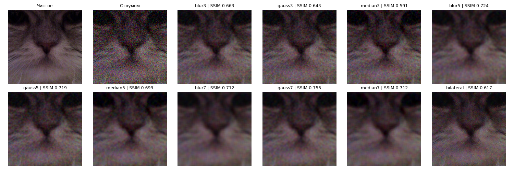
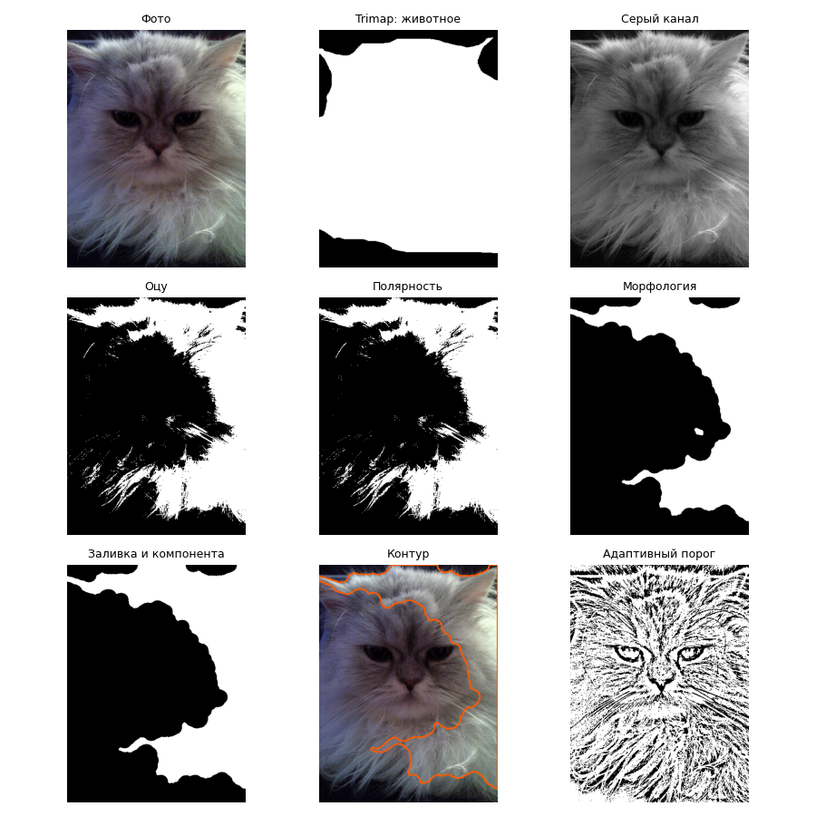
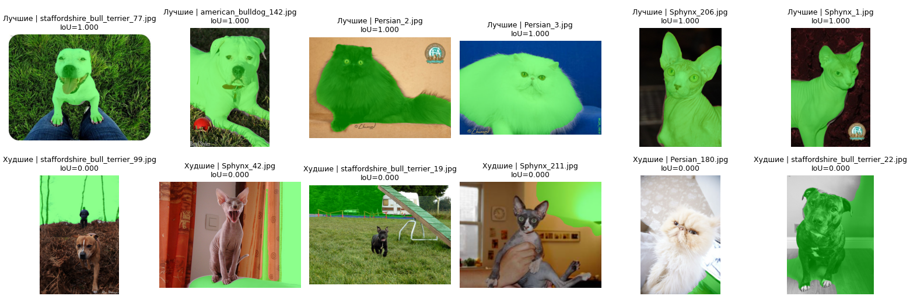

# Лабораторная работа № 2. Классическая обработка изображений

## 1. Задача

Сравнить способы коррекции освещённости и подавления шума, а затем выделить животное на фото без нейросети. Оценить вклад этапов сегментации по IoU и измерить признаки формы итоговых масок.

## 2. Как запустить

Откройте [solution.ipynb](solution.ipynb) в Google Colab, оставьте `VARIANT = 9` и выберите **Runtime → Run all**. GPU не нужен. Первая ячейка скачивает данные курса, а результаты сохраняются в `results/`. Для локального запуска дополнительно нужны `scikit-image` и `PyWavelets`. Полный расчёт выполнен и проверен локально на CPU. Время фильтрации зависит от машины.

## 3. Данные

Вариант 9, Oxford-IIIT Pet v1, **797 фото**. Породы: персидская кошка (Persian), сфинкс (Sphynx), американский бульдог (American Bulldog) и стаффордширский бультерьер (Staffordshire Bull Terrier). По `NOISE_PLAN` на **30** кадров добавлялся гауссов шум с σ = 25. В расчёте IoU граничные пиксели trimap не учитываются.

## 4. Результаты

| Показатель | Значение |
|---|---:|
| PSNR / SSIM без фильтра | 20.63 дБ / 0.3078 |
| PSNR / SSIM после `gauss7` | 28.52 дБ / 0.7550 |
| Время `gauss7` | 0.420 мс на кадр |
| Выбранный канал сегментации | `gray` |
| Средний IoU, только Оцу | 0.342 |
| Средний IoU, полный пайплайн | 0.479 |

[Статистика](results/part1_stats.csv) · [Гистограммы](results/histograms.png) · [Коррекция яркости](results/illumination.png) · [Фильтры](results/filters.csv) · [Сравнение этапов](results/ablation.csv) · [Маски и признаки формы](results/masks.csv)

## 5. Выводы

1. **Подавление шума.** У `gauss7` средний SSIM 0.7550 против 0.3078 у зашумлённых кадров. Второе место по SSIM занял `blur5` с 0.7244, а максимальный PSNR дал `gauss5` (28.66 дБ). PSNR измеряет пиксельную ошибку, а SSIM оценивает сходство локальной структуры, поэтому для сегментации фильтр выбран по SSIM.
2. **Яркость.** Средняя яркость L отдельных фото лежала в диапазоне 31.2–223.5 по шкале 0–255. Наименьшую среднюю яркость по породе получила `Sphynx` (115.0). Большой разброс между кадрами показывает, почему единственная фиксированная поправка яркости может быть недостаточной для всего набора.
3. **Канал.** Из двух каналов для сегментации выбран `gray`: средний IoU составил 0.479 для `gray` и 0.392 для `S`. Порог Оцу разделяет пиксели по одному признаку, поэтому результат зависит от того, насколько животное и фон различаются именно по яркости или насыщенности.
4. **Вклад этапов.** Средний IoU изменился с 0.342 до 0.479. Наибольший прирост между соседними строками таблицы дал этап «+ полярность» (+0.084). Исправление полярности может заменить выделенный фон объектом, морфология очищает маску, а заливка и выбор компоненты оставляют цельную область. Эти эвристики полезны, когда первоначальный порог уже отделил хотя бы часть животного от фона.
5. **Сложные кадры.** У 173 из 797 фото итоговый IoU ниже 0,2. Самый низкий средний IoU по породе получен для `staffordshire_bull_terrier` (0.433). Низкий IoU означает, что маска слабо совпала с разметкой: выбор крупнейшей компоненты не может исправить кадры, где порог выделяет в первую очередь фон.
