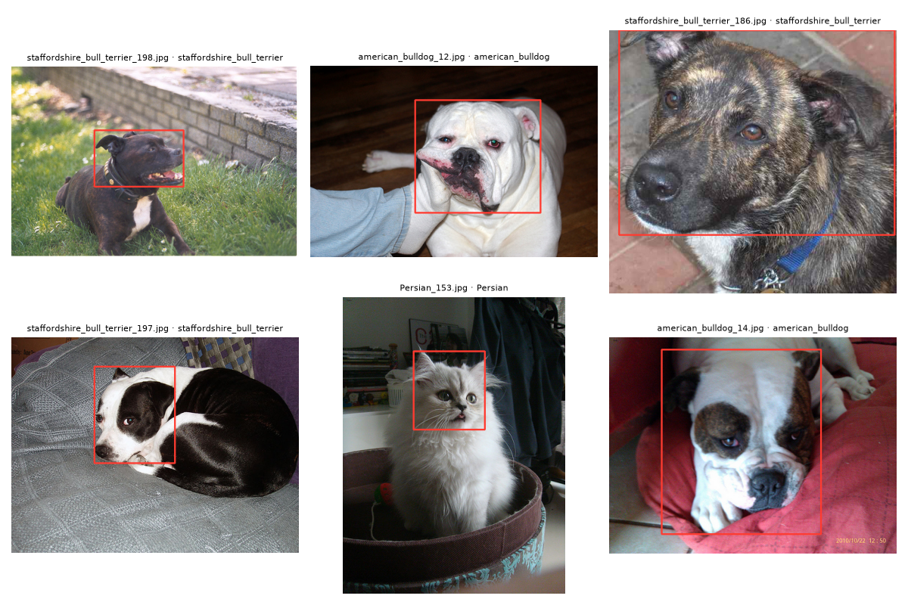
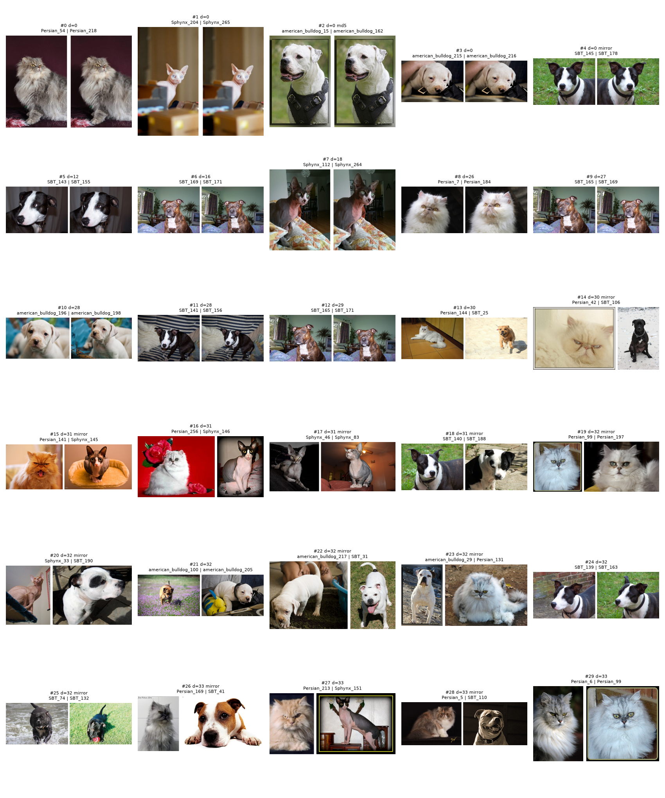
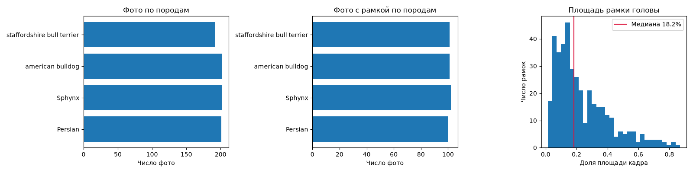
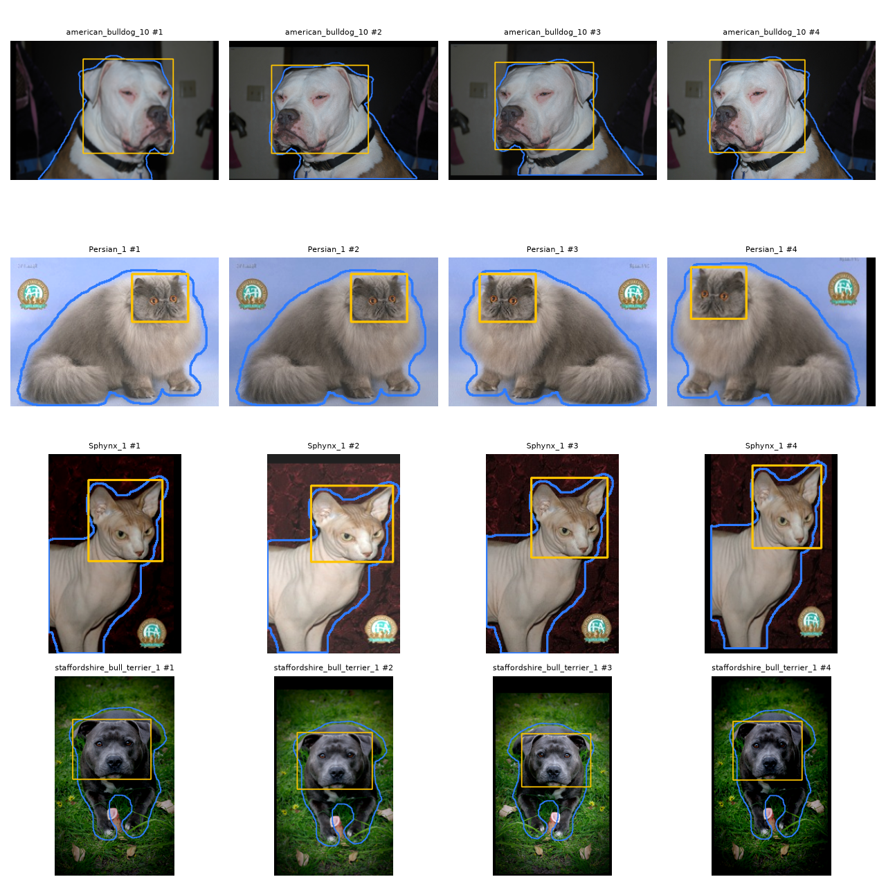
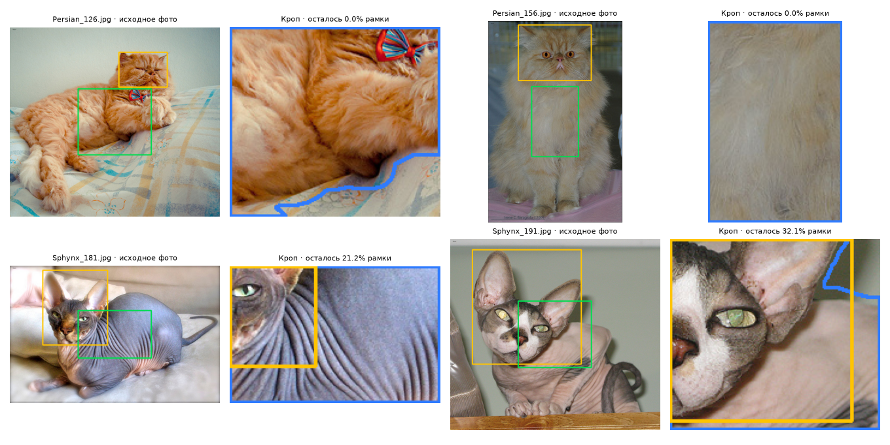

# Лабораторная работа № 3. Разметка, дубликаты, разбиение и аугментации

**София Кавалеристова · вариант 9**

## 1. Задача

Проверить разметку Oxford-IIIT Pet и преобразовать её в COCO для сегментации и YOLO для детекции голов. Найти копии и серии снимков, измерить утечку при случайном разбиении и проверить, как аугментации меняют фото, маски и рамки.

## 2. Как запустить

Откройте [solution.ipynb](solution.ipynb) в Jupyter или Google Colab, оставьте `VARIANT = 9` и выберите **Run All**. В Kaggle включите **Settings → Internet → On**. Ноутбук загружает вариант из релиза курса. Если архив уже скачан, можно задать `DATA_SOURCE` как путь к папке с `variant_09.zip`. Полный расчёт проверен локально в Jupyter на CPU с Python 3.12 и официальным архивом. Повторный запуск дал тот же `split.csv`.

Для локальной среды нужны NumPy, Pandas, Pillow, OpenCV, Matplotlib и SciPy. Ноутбук проверяет версии ImageHash 4.3.2, Albumentations 2.0.8 и scikit-learn 1.7.2 и при необходимости устанавливает их. Файлы записываются в `results/` относительно рабочей папки ноутбука. В Colab и Kaggle дополнительно создаётся `results.zip`.

## 3. Данные

Использован [официальный архив Oxford-IIIT Pet v1 для варианта 9](https://github.com/ykvnkm/computer-vision-course/releases/download/data-v1/variant_09.zip). Всего 797 фото и 404 рамки головы.

| Класс | Порода | Фото | Рамки головы |
|---:|---|---:|---:|
| 0 | Персидская кошка | 201 | 100 |
| 1 | Сфинкс | 202 | 102 |
| 2 | Американский бульдог | 202 | 101 |
| 3 | Стаффордширский бультерьер | 192 | 101 |

Трудная пара для классификации — американский бульдог и стаффордширский бультерьер. На портретах обеих пород встречаются широкие головы, короткая шерсть и сходная бело-пятнистая окраска. Для маски выбрано `BORDER_AS = "animal"`. Значения trimap 1 и 3 включены в объект, чтобы сохранить переходную зону по краям силуэта.

## 4. Результаты

| Показатель | Значение |
|---|---|
| Фото с замечаниями | 3 из 797. У всех трёх пустая trimap, у двух из них режим JPEG `L`. Неверных размеров, выходов рамок за кадр, нескольких рамок на фото и совпадений рамки с маской менее чем на 50% нет |
| Экспорт COCO / YOLO | 797 записей о фото и 794 объекта COCO, 404 файла YOLO |
| IoU после восстановления COCO-полигонов | Медиана 0,9963. Минимум по всем фото 0,0000 (пустые маски, IoU принят за 0). По непустым минимум 0,7758 |
| Максимальная ошибка VOC → YOLO → VOC | 0,000300 пикселя |
| Вердикты по 30 ближайшим парам | 6 `same` (из них 1 побайтовая копия), 8 `series`, 16 `different` |
| Группы | 784 всего, из них 12 групп с 25 снимками |
| Разрывы групп в 100 случайных разбиениях | В среднем 5,47 группы между любыми выборками и 2,94 одновременно в train и test |
| Разрывы после группового разбиения | 0 |
| Центральный кроп 35% × 35% | Меньше половины головы сохранилось на 331 из 404 фото (81,93%). Голова целиком вне кадра на 16 из 404 фото (3,96%) |

| Выборка | Фото | С рамкой | С непустой маской | Персидская | Сфинкс | Бульдог | Бультерьер |
|---|---:|---:|---:|---:|---:|---:|---:|
| Train | 571 | 291 | 568 | 25,4% | 25,4% | 25,0% | 24,2% |
| Val | 113 | 57 | 113 | 24,8% | 24,8% | 26,5% | 23,9% |
| Test | 113 | 56 | 113 | 24,8% | 25,7% | 25,7% | 23,9% |

[Аудит](results/audit.csv) · [COCO](results/coco.json) · [YOLO](results/yolo/) · [Вердикты пар](results/dup_pairs.csv) · [Разбиение](results/split.csv) · [Сводка разбиения](results/split_summary.csv)

## 5. Выводы

1. У трёх снимков trimap целиком состоит из фона, в том числе у двух полутоновых JPEG. Эти фото сохранены в классификационном наборе. Для COCO они внесены в список изображений без объектов, поэтому получилось 794 аннотации на 797 фото.
2. Медианный IoU после восстановления из полигонов составил 0,9963. У `Persian_273.jpg` IoU равен 0,7758. Внешние контуры после заливки закрывают отверстия и сглаживают границы, поэтому совпадение может снижаться.
3. Из 30 пар совпали 6 фотографий и 8 серий. У зеркальной пары `staffordshire_bull_terrier_145/178` расстояние равно 0, а 16 пар получили `different`. Хэши реагируют на сходство общей композиции, поэтому близкий хэш требует визуальной проверки.
4. При случайном разбиении в среднем 2,94 группы одновременно попадали в train и test. После разбиения по группам таких случаев 0, а доля каждой породы в каждой выборке лежит в диапазоне 23,9–26,5%. Копии и кадры известных серий остаются внутри одной выборки.
5. После центрального кропа 35% × 35% меньше половины рамки сохранилось на 331 из 404 фото. Такой кроп часто отсекает голову даже у животного рядом с центром. Для train выбраны отражение, масштаб 0,9–1,1, сдвиг до 5%, умеренная коррекция яркости и контраста и лёгкое гауссово размытие. Для val и test применяется только изменение длинной стороны до 640 пикселей.

Группа — связная компонента графа, где рёбрами служат побайтовые копии и пары `same` или `series`, найденные при проверке 30 ближайших пар. Одиночное фото образует свою группу. `StratifiedGroupKFold` с семью фолдами и `random_state=2026` удерживает каждую найденную группу целиком и приближает доли пород друг к другу. Пять фолдов образуют train, по одному выделено для val и test. Оценка утечек относится к найденным группам.

